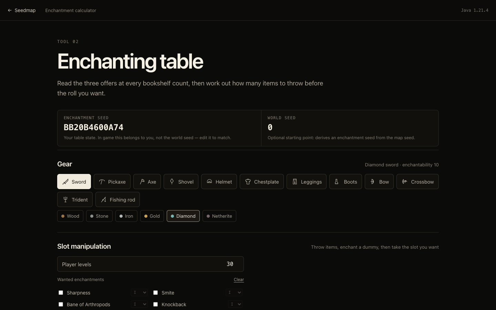
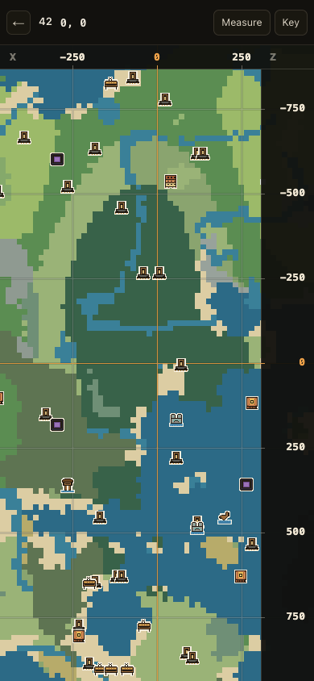
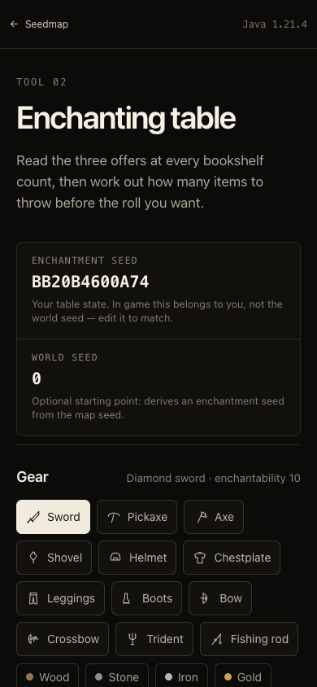
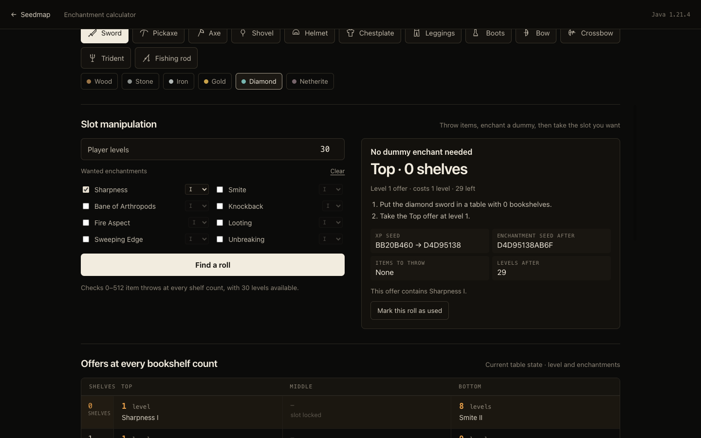

# Seedmap — offline Minecraft seed atlas

**[Open `seedmap.svg`](seedmap.svg)** in any modern browser (double-click it). It is one
self-contained SVG: markup, CSS, JavaScript and the generator are inline, and it makes no
network requests.

Seedmap draws the surface biomes, structures and strongholds of a Minecraft Java seed, then
lets you read coordinates, measure a route between points, or open the **Enchanting table**
calculator. It works from `file://`, with no build step or server. Source:
[aerograde/seedmap](https://github.com/aerograde/seedmap).

The chrome is deliberately quiet: a single near-black surface, warm cream type, monospace
labels, and no decorative colour beyond the map, the small material swatches and one amber
accent. Structure markers are sticker sprites — 16×16 pixel art with a cream outline and a
soft shadow, no plate or halo behind the art. They are 18 px at the widest zoom, where a
small sprite keeps the terrain readable, and grow to 24 px once shapes need to be told
apart. The map's coordinate labels live on two reserved bands that are painted after the
markers, so they cannot be covered.

| Home | Map |
| --- | --- |
|  |  |

| Measure | Enchanting table |
| --- | --- |
|  |  |

| Phone map | Phone key |
| --- | --- |
|  |  |

| Enchanting table on a phone | Slot manipulation |
| --- | --- |
|  |  |


## Use

1. Type a seed (a Java Edition number, or any word) and press **Enter** or click **Show the map**.
2. Drag to pan, scroll or pinch to zoom, and double-click to zoom in.
3. Press **Measure** (or `M`) and click the map to place points. From the second point on,
   the map shows each leg, the total route and an estimated walking/sprinting time.
4. Hover a structure marker to see its name and block coordinates.
5. Press **Esc** to leave measuring, or again to return to the seed box.
6. Open **Enchanting table** from the quiet button in the home screen's bottom-right corner.
   **Esc** or the back button returns to the seed box.

Keyboard: `M` toggles measuring, `+`/`-` zoom, the arrow keys pan, `Backspace` removes the
last measurement point, and `Esc` steps back.

The map page has only its map tools. The home screen is made inert while the map or the
enchanting table is open (and its input is also disabled while the map is open), so Tab and
Enter cannot reach or resubmit the hidden form.

## Enchanting table

The calculator is a separate view inside the same SVG, reached from the bottom-right button
on the seed screen. It follows the model used by
[Earthcomputer/EnchantmentCracker](https://github.com/Earthcomputer/EnchantmentCracker):
a 48-bit player seed drives the table, each use takes its top 32 bits as that use's XP seed,
and offers can be moved by throwing items and enchanting a dummy.

- **Seeds:** the **enchantment seed** is the primary field and the state every offer and
  plan uses. In game this 48-bit value belongs to the player, not the world, so the field is
  editable and labelled as such. A **world seed** field sits beside it as an optional
  starting point: it derives a beginning state with one `Random(worldSeed)` draw, clearly
  labelled as a convenience rather than a game mechanic. The current XP seed is shown in
  each plan.
- **Gear and material:** sword, pickaxe, axe, shovel, helmet, chestplate, leggings, boots,
  bow, crossbow, trident and fishing rod. Tools and armour use their real material
  enchantability (wood 15, stone 5, iron 14/9, gold 22/25, diamond 10, netherite 15,
  leather 15, chain 12). Ranged gear, tridents and rods use enchantability 1.
- **Offers at every bookshelf count:** all 16 rows use the current seed, so you can compare
  the top, middle and bottom offer from 0 to 15 bookshelves. Slot levels come from one
  `Random(xpSeed)` stream using the vanilla base roll `randomInt(1,8) + floor(b/2) +
  randomInt(0,b)`, then the three slot transforms: top `max(floor(base/3), 1)`, middle
  `floor(base*2/3) + 1`, bottom `max(base, b*2)`. A slot whose level is below its own index
  is shown as locked. Each offer lists its level and the enchantments rolled from
  `Random(xpSeed + slot)`, using the real enchantability modifiers, weighted tier selection,
  conflict removal and the repeating `/50` bonus roll. Treasure enchantments never appear.
- **Slot manipulation:** pick the enchantments and minimum tiers you want, a player level
  and a maximum shelf count, then **Find a roll**. The search walks the seed forward through
  0–512 thrown items at every shelf count. A plan states how many items to throw (four seed
  steps each), whether a dummy enchant is needed (one step and one level), the bookshelf
  count and slot to use, the seed before and after, and the levels left. **Mark this roll as
  used** advances the calculator to that state so the offers table shows the next roll.
- **No network:** the table model runs locally in `src/enchant.js`.

## What it shows

- Surface biomes for Minecraft **Java 1.21.4, the Winter Drop** (cubiomes' `MC_1_21_WD`,
  which includes Pale Garden), sampled above terrain at block y = 316 (noise y = 79), so
  the atlas shows the column's surface biome rather than caves.
- Structures: village, ocean monument, pillager outpost, woodland mansion, ancient city,
  trial chambers, desert pyramid, jungle temple, swamp hut, igloo, shipwreck, ocean ruin,
  trail ruins, buried treasure, mineshaft, ruined portal, and stronghold.
- Every structure type has its own 16×16 pixel-art icon, drawn in the key, on the map and in
  the hover card as a sticker: the art sits in a cream outline with a soft shadow and no
  opaque plate, disc or margin. Each family has a distinct silhouette and palette — a
  villager's head for a village, a prismarine frame for a monument, a banner-topped tower
  for an outpost, a dark lantern for an ancient city, a copper door for trial chambers, a
  sand ziggurat, a mossy temple, a witch's stilt hut, a snow dome, an anchor for a wreck,
  broken columns, a gold chest, a minecart, a purple portal, and the stronghold's eye.
  [screenshots/icons.png](screenshots/icons.png) shows all 17 at 24, 32 and 48 px, and
  [screenshots/icons-phone.png](screenshots/icons-phone.png) shows them at phone width.
- Every structure keeps its own icon at every zoom level. Nothing is demoted to a dot or
  dropped by an icon budget: all 17 families use the same sprites at 18–24 px (smaller at
  wide zoom so the marker field leaves the terrain readable), and dense families are painted
  first so the rarer icons stay on top. The key renders the same art at 24 px at phone width.
- A labelled coordinate grid, with X values across a fixed top ruler and Z values down the
  right rail. The interval follows zoom: **500 blocks** at the 0.22 overview, **250** at the
  default 0.55 scale, and **50** at 2 px/block. Labels stay at least 100 px apart on desktop
  and 80 px on phones; a label near a canvas edge takes the outward alignment so it stays
  whole, and the rail widens for a long Z coordinate instead of clipping it. The bands are
  opaque and painted after the map and its markers, so no icon can cover a number. The route
  card and the scale badge sit inside the map field, so they never cover the rail. The X
  ruler does not move when Measure opens. The X = 0 and Z = 0 axes are the only orange lines
  on the map.
- A complete colour key. The map paints 54 biome colours. The key accounts for every one of
  them with 19 entries: 13 visually coherent families plus separate entries for Cherry
  Grove, Mushroom Fields, Dripstone Caves, Deep Dark, Pale Garden and Unknown. Structure
  names are a single full-width column, so none are truncated. On phones the key is a
  drawer behind the **Key** button and scrolls inside the viewport.

## Distance and travel time

Measurements use horizontal world coordinates. From two or more points, every leg is drawn
with its own block distance (`sqrt(dx² + dz²)`), and the panel shows the sum of the legs.
Time is the straight-line distance divided by Minecraft's flat-ground walking speed
(**4.317 blocks/s**) or sprinting speed (**5.612 blocks/s**). It deliberately ignores terrain,
obstacles, hunger, boats, portals and other transport. The panel labels the route as
straight-line so the estimate is not mistaken for a pathfinding result.

## Fidelity and deliberate approximations

The engine in `src/engine.js` is a JavaScript port of the relevant parts of
[Cubitect/cubiomes](https://github.com/Cubitect/cubiomes) (MIT): Xoroshiro128++, Java LCG,
Perlin octave noise, the 1.21 climate router and splines, the packed 1.21 biome-parameter
search tree, structure region placement, and `isViableStructurePos` for the 16
non-stronghold structure families shown.

- **Climate / surface biome:** compared with cubiomes' `MC_1_21_WD` generator at **8,028
  random block coordinates** across four seeds (2,007 points each, mostly within ±6,000
  blocks plus far points to ±20,000). Every biome matched. `World.biomeAtBlock(x, z)` is
  the only biome entry point; the block-to-noise conversion happens there, so the UI cannot
  pass the wrong coordinate space.
- **Structures:** 18,496 region attempts across four seeds (289 attempts per type per
  seed, ±8 regions) were compared with cubiomes. Viability, raw placements and marker
  centers agreed for all 16 non-stronghold types at 100%. A further 80,802 per-chunk
  attempts for buried treasure and mineshafts on seed 0 (±100 chunks around origin) also
  agreed exactly. Village viability includes the five biome variants, monuments the 5×5
  corner/area check, outposts the 1-in-5 check plus the ten-chunk village exclusion, ancient
  cities and trial chambers their Jigsaw variants at the correct depth, trail ruins its
  six-biome set, and buried treasure its 1% salted chunk roll.
- **2D surface sampling:** the atlas samples block y = 316 (noise y = 79, the same noise
  layer as vanilla's 319) rather than tracing each column's terrain height. This is the
  usual seed-map approximation; mountain/cave layers and the exact block on which a biome
  starts are not modelled.
- **LOD:** biome cells are never coarser than 16 blocks. At a **1440 × 900** viewport and
  the 0.22 px/block minimum zoom, the widest 2D view is about **6,545 × 4,091 blocks** and
  is still sampled at 1:16. It is not a 1:4 full-world render; tiny biome slivers can shift
  or vanish at overview scale.
- **Structures are placed exactly:** the map tests the same biome viability as cubiomes for
  the 16 types above, but it does not run vanilla's terrain-height or bounding-box
  generation. Markers should match `/locate structure` for these types on this version;
  unlisted types remain absent.
- **Underground:** ancient cities (y = −27), trial chambers (y = −40…−20), buried treasure
  and mineshafts are underground structures. Their markers show the generated placement,
  not a surface entrance or a safe route down.
- **Dense types:** buried treasure and mineshafts are per-chunk features. They are
  generated in 256-block cells and drawn as their own scaled stickers like every other
  family. They are never culled by zoom level or reduced to dots — every generated marker is
  drawn — and they are not silently omitted. Because mineshafts are the most numerous, they
  sit underneath the rarer icons in the draw order so a lone stronghold or monument cannot be
  hidden.
- **Strongholds:** all 128 use cubiomes' exact `initFirstStronghold()` /
  `nextStronghold()` sequence: the vanilla ring approximate point, a 112-block
  `locateBiome()` search for a valid stronghold biome at block y = 0 (including the
  order-dependent `climateToBiome` leaf cache), and the staircase offset to the chunk's
  (4, 4) corner. All **640 / 640** positions across five seeds agreed exactly.
- **Not included:** desert wells, geodes, nether/end structures, slime chunks, spawn point
  and biome-specific structure variants. The key does not name every one of the 60+ biome
  IDs individually, but every colour the map can paint resolves to an exact chip in one of
  its 19 entries.
- **Zoom range:** 0.22–8 px per block. The lower bound keeps an overview readable with the
  number of samples a single browser tab can generate; structures are re-enumerated as you
  pan and appear progressively, and the dense per-chunk layer is built in coarse cells so
  the sparse region queue never runs one job per chunk.

Generation runs incrementally (a fast 4× preview pass, then detailed rows, plus a per-frame
structure queue and 2 ms dense-structure slices), so the page stays responsive while a new
area is drawn. The 128 stronghold searches are streamed in 12 ms slices after the map opens,
so the first frame is not blocked by their biome scans. Verified in Chromium at `file://` at
1440×900 and 390×844 (map at overview and close zoom, the coordinate grid, measure, the key,
marker hover, both icon sheets, and the enchanting table including a slot-manipulation plan)
with no console errors; screenshots live in [screenshots](screenshots).

## Rebuilding

```
python3 tools/build.py
```

The sources are one file per concern, and `tools/build.py` inlines them in dependency
order: `util` → `biomes` → `data` → `engine` → `enchant` → `icons` → `terrain` → `grid` →
`measure` → `map` → `calc` → `app`, plus `style.css` and `template.svg`. `app.js` is only
the home flow and routing; `terrain.js` owns tiles and structure enumeration, `grid.js` the
coordinate bands, `measure.js` the route tool, `map.js` the camera and drawing, and
`calc.js` the calculator's markup, state and rendering. `tools/test_engine.js` compares the JS
engine with the committed block-space cubiomes dumps in `tools/reference/`; it does not use
noise-space probes as evidence. `tools/test_enchant.js` checks the Java random stream, offer
ranges, treasure exclusions, item pools and seed/level arithmetic behind slot manipulation:

```
node tools/test_engine.js                 # block-space biomes, seed 0
node tools/test_engine.js --structures    # all 16 non-stronghold types and centers
node tools/test_engine.js --dense         # treasure/mineshaft chunk parity
node tools/test_engine.js --strongholds   # all 128 relocated strongholds, seed 0
node tools/test_enchant.js                # table streams, offers and slot plans
```

## Credits

- Biome and structure reference: [Cubitect/cubiomes](https://github.com/Cubitect/cubiomes),
  MIT.
- Enchanting table and slot-manipulation model:
  [Earthcomputer/EnchantmentCracker](https://github.com/Earthcomputer/EnchantmentCracker),
  MIT.
- Structure-icon visual language inspired by [mcseedmap.net](https://mcseedmap.net); the
  pixel art in `src/icons.js` is original to this project.
