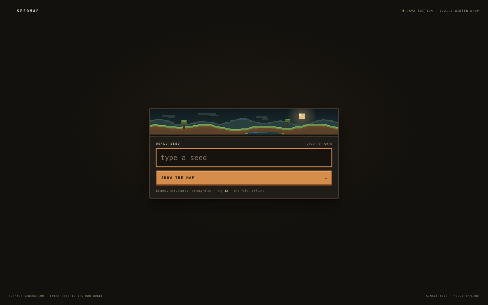
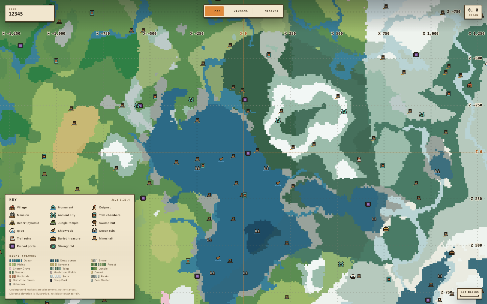
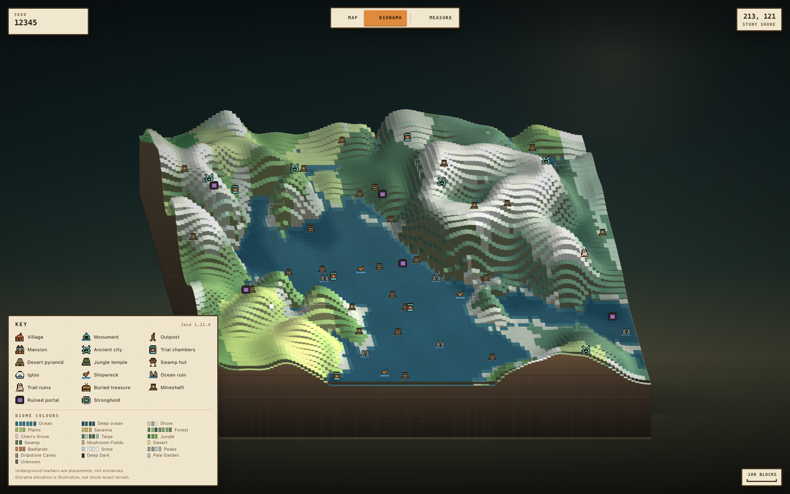
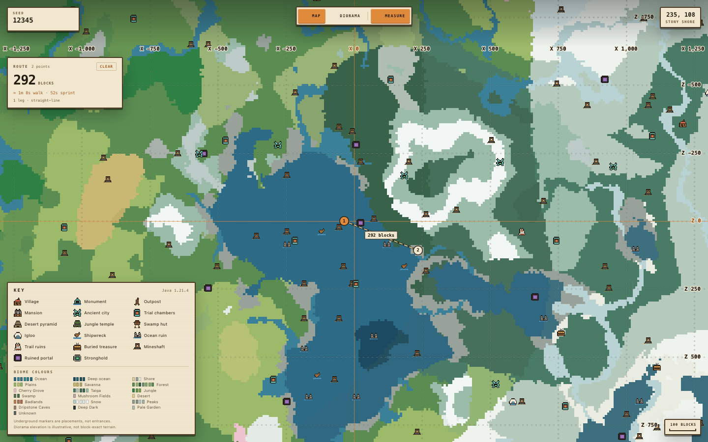
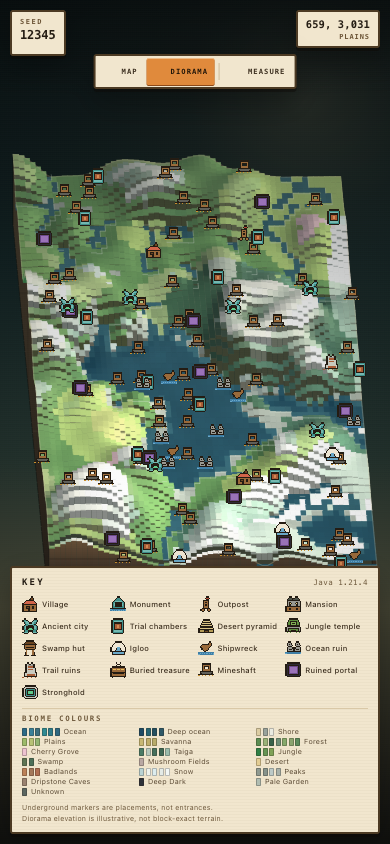
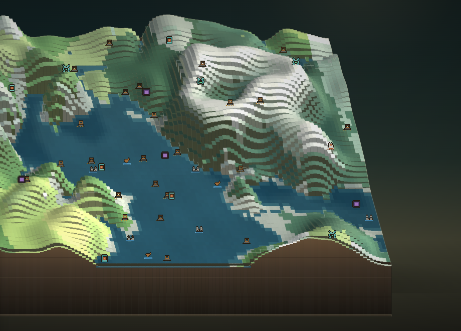
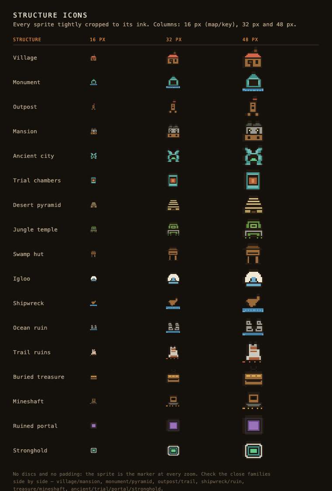

# Seedmap — offline Minecraft seed atlas

**[Open `seedmap.svg`](seedmap.svg)** in any modern browser (double-click it). It is one
self-contained SVG: markup, CSS, JavaScript and the generator are inline, and it makes no
network requests.

Seedmap draws the surface biomes, structures and strongholds of a Minecraft Java seed, then
lets you tilt that map into a **Diorama**, measure a route between points, and read the
distance and an estimated travel time. It works from `file://`, with no build step or server.
Source: [aerograde/seedmap](https://github.com/aerograde/seedmap).

The chrome is a cartographer's field guide rather than a generic dark dashboard: parchment
panels, beveled orange controls, monospace labels, a generated pixel horizon on the seed
card, and a 16×16 pixel-art icon for every structure type.

| Home | Map |
| --- | --- |
|  |  |

| Diorama | Measure |
| --- | --- |
|  |  |

| Mobile key | Mobile diorama |
| --- | --- |
|  |  |

| Diorama detail | All structure icons |
| --- | --- |
|  |  |

## Use

1. Type a seed (a Java edition number, or any word) and press **Enter** or click **Show the map**.
2. Use **Map** for the top-down atlas, or **Diorama** for the angled 3D view. Drag to pan,
   scroll/pinch to zoom, and double-click to zoom in.
3. Press **Measure** (or `M`) and click the map to place points. From the second point on,
   the map shows each leg, the total route and an estimated walking/sprinting time.
4. Hover a structure marker to see its name and block coordinates.
5. Press **Esc** to leave measuring, or again to return to the seed box.

The map page has only its map tools. The home seed form is made inert and its input disabled
while the map is open, so Tab and Enter cannot reach or resubmit the hidden form.

Keyboard: `M` toggles measuring, `D` toggles Diorama, `+`/`-` zoom, the arrow keys pan,
`Backspace` removes the last measurement point, and `Esc` steps back.

## What it shows

- Surface biomes for Minecraft **Java 1.21.4, the Winter Drop** (cubiomes' `MC_1_21_WD`,
  which includes Pale Garden), sampled above terrain at block y = 316 (noise y = 79), so
  the atlas shows the column's surface biome rather than caves.
- Structures: village, ocean monument, pillager outpost, woodland mansion, ancient city,
  trial chambers, desert pyramid, jungle temple, swamp hut, igloo, shipwreck, ocean ruin,
  trail ruins, buried treasure, mineshaft, ruined portal, and stronghold.
- Every structure type has its own 16×16 pixel-art icon, drawn in the key, directly on
  the map and diorama, and in the hover card. Each sprite is cropped to its ink and fitted
  to its 16×16 slot, so there is no cream disc, halo or empty margin around the art. The
  silhouettes do not share a generic fallback: a red-roofed timber village house; a slate
  twin-gable mansion; a narrow banner-topped outpost tower; a teal stepped monument on
  water; a dark sculk arch with a green core (ancient city); a copper door with an orange
  lock (trial chambers); a flat-topped sand ziggurat; a mossy, vine-hung jungle temple; a
  stilt hut with a dark roof; a white dome with a blue entrance (igloo); a tilted, broken
  hull; two broken stone columns in water; a cracked stone tower banded with rust (trail
  ruins); an open gold chest; a minecart on rails inside a timber frame; an
  obsidian-and-purple portal; and a stone ring around a green eye (stronghold).
  [screenshots/icons.png](screenshots/icons.png) shows all 17 at 16, 32 and 48 px side by
  side; [screenshots/icons-phone.png](screenshots/icons-phone.png) is the same set on a
  phone-width sheet.
- Every structure keeps its own icon at every zoom level. Nothing is demoted to a dot or
  dropped by an icon budget: all 17 families are drawn from the same 16×16 sprites, and
  dense families are painted first so the rarer icons stay on top. The key renders the
  same 16px art at phone width. Hover identifies an individual marker; the key lists every
  type.
- A labelled coordinate grid, with X values across the top edge and Z values down the
  right edge. Its interval follows zoom: **500 blocks** at the 0.22 overview, **250** at
  the default 0.55, and **50** at 2 px/block. Labels stay at least 100 px apart on desktop
  and 80 px on phones, so they never pile up. The X = 0 and Z = 0 axes are drawn in orange.
  Values are outlined ink text painted after the icons, so no opaque plate hides a
  structure. Labels are kept clear of the seed, readout, tools, measure card, key and
  hint; edge labels slide inward and a Z label blocked by the readout slides left along
  its line, or to the nearest clear row if the edge stays crowded. The X ruler sits in
  one fixed band below the top controls, so it stays put as the key hint fades and as the
  measure card opens beneath it.
- A complete colour key. The map paints 54 biome colours. The key accounts for every one of
  them with 19 entries: 13 visually coherent families plus separate entries for Cherry
  Grove, Mushroom Fields, Dripstone Caves, Deep Dark, Pale Garden and Unknown. The key is
  present and complete at desktop and mobile widths, including short viewports.

## Diorama

Diorama is an angled, stepped relief model of the same seed. It is a deliberate visual
interpretation, not a block-by-block ray trace:

- Elevation is the density zero-crossing from the same climate sample used for the biome
  lookup, not a hand-authored biome height. Water columns are flattened to one sea plane.
  The mesh is baked as flat terraces with a cut face under every real drop, so hillsides
  read as landforms instead of stretched vertical smears. A low-sun hillshade and a
  softened cast-shadow pass add form; elevation is exaggerated by about 2.5× at the default
  view and up to 3× at overview zoom, easing back as you zoom in, viewed at a 50° angle.
- The map is a finite slab with cut front, left, right and back faces, a beveled foot and
  sky around it, like a model on a table. A small horizontal skew gives a three-quarter
  view, so both side faces are visible instead of the slab reading as a tilted sheet. The
  water is one flat sea plane with a pale surf line at every coast; the cut faces are
  tinted by the ground above them and banded like packed earth. The model is framed rather
  than filling the viewport, and on a phone it is lifted above the key.
- The surface is generated in rows in 5.5 ms slices; a new mesh starts from a clean sky
  and streams in, so an old projection is not left on screen while it rebuilds. It can be
  panned and zoomed with the same camera as the 2D atlas.
- It does **not** model caves, overhangs, trees, individual blocks or the exact Y of a
  structure. Underground structures remain placement markers. The key note says the
  elevation is illustrative.

The mode is inspired by [**Diorama**](https://github.com/SunkenInTime/diorama), SunkenInTime's
Fabric/NeoForge minimap and world map that ray traces real chunk data. Seedmap is a standalone
SVG and does not include that mod or require it.

## Distance and travel time

Measurements use horizontal world coordinates. From two or more points, every leg is drawn
with its own block distance (`sqrt(dx² + dz²)`), and the panel shows the sum of the legs.
Time is the straight-line distance divided by Minecraft's flat-ground walking speed
(**4.317 blocks/s**) or sprinting speed (**5.612 blocks/s**). It deliberately ignores terrain,
obstacles, hunger, boats, portals and other transport. The panel labels the route as
straight-line so the estimate is not mistaken for a pathfinding result.

## Fidelity and deliberate approximations

The engine in `src/engine.js` is a JavaScript port of the relevant parts of
[Cubitect/cubiomes](https://github.com/Cubitect/cubiomes) (MIT): Xoroshiro128++, Java LCG,
Perlin octave noise, the 1.21 climate router and splines, the packed 1.21 biome-parameter
search tree, structure region placement, and `isViableStructurePos` for the 16
non-stronghold structure families shown.

- **Climate / surface biome:** compared with cubiomes' `MC_1_21_WD` generator at **8,028
  random block coordinates** across four seeds (2,007 points each, mostly within ±6,000
  blocks plus far points to ±20,000). Every biome matched. `World.biomeAtBlock(x, z)` is
  the only biome entry point; the block-to-noise conversion happens there, so the UI cannot
  pass the wrong coordinate space.
- **Structures:** 18,496 region attempts across four seeds (289 attempts per type per
  seed, ±8 regions) were compared with cubiomes. Viability, raw placements and marker
  centers agreed for all 16 non-stronghold types at 100%. A further 80,802 per-chunk
  attempts for buried treasure and mineshafts on seed 0 (±100 chunks around origin) also
  agreed exactly. Village viability includes the five biome variants, monuments the 5×5
  corner/area check, outposts the 1-in-5 check plus the ten-chunk village exclusion, ancient
  cities and trial chambers their Jigsaw variants at the correct depth, trail ruins its
  six-biome set, and buried treasure its 1% salted chunk roll.
- **2D surface sampling:** the atlas samples block y = 316 (noise y = 79, the same noise
  layer as vanilla's 319) rather than tracing each column's terrain height. This is the
  usual seed-map approximation; mountain/cave layers and the exact block on which a biome
  starts are not modelled.
- **LOD:** biome cells are never coarser than 16 blocks. At a **1440 × 900** viewport and
  the 0.22 px/block minimum zoom, the widest 2D view is about **6,545 × 4,091 blocks** and
  is still sampled at 1:16. It is not a 1:4 full-world render; tiny biome slivers can shift
  or vanish at overview scale.
- **Structures are placed exactly:** the map tests the same biome viability as cubiomes for
  the 16 types above, but it does not run vanilla's terrain-height or bounding-box
  generation. Markers should match `/locate structure` for these types on this version;
  unlisted types remain absent.
- **Underground:** ancient cities (y = −27), trial chambers (y = −40…−20), buried treasure
  and mineshafts are underground structures. Their markers show the generated placement,
  not a surface entrance or a safe route down.
- **Dense types:** buried treasure and mineshafts are per-chunk features. They are
  generated in 256-block cells and drawn as their own 16px icons like every other family.
  They are never culled by zoom level or reduced to dots — every generated marker is drawn
  — and they are not silently omitted. Because mineshafts are the most numerous, they sit
  underneath the rarer icons in the draw order so a lone stronghold or monument cannot be
  hidden.
- **Strongholds:** all 128 use cubiomes' exact `initFirstStronghold()` /
  `nextStronghold()` sequence: the vanilla ring approximate point, a 112-block
  `locateBiome()` search for a valid stronghold biome at block y = 0 (including the
  order-dependent `climateToBiome` leaf cache), and the staircase offset to the chunk's
  (4, 4) corner. All **640 / 640** positions across five seeds agreed exactly.
- **Not included:** desert wells, geodes, nether/end structures, slime chunks, spawn point
  and biome-specific structure variants. The key does not name every one of the 60+ biome
  IDs individually, but every colour the map can paint resolves to an exact chip in one of
  its 19 entries.
- **Zoom range:** 0.22–8 px per block. The lower bound keeps an overview readable with the
  number of samples a single browser tab can generate; structures are re-enumerated as you
  pan and appear progressively, and the dense per-chunk layer is built in coarse cells so
  the sparse region queue never runs one job per chunk. The key is labelled `Java 1.21.4`
  and the home tag reads `Java Edition · 1.21.4 Winter Drop`, so Pale Garden and the other
  winter-drop biomes are not mistaken for base 1.21.

Generation runs incrementally (a fast 4× preview pass, then detailed rows, plus a per-frame
structure queue and 2 ms dense-structure slices), so the page stays responsive while a new
area is drawn. Diorama rows are generated in 5.5 ms slices. The 128 stronghold searches are
streamed in 12 ms slices after the map opens, so the first frame is not blocked by their
biome scans. Verified in Chromium at `file://` at 1440×900 and 390×844 (map at full zoom-out, the
labelled grid at overview and 2 px/block, measure, diorama, marker hover, and both icon
sheets) with no console errors; screenshots live in [screenshots](screenshots).

## Rebuilding

```
python3 tools/build.py
```

`src/engine.js` + `src/data.js` + `src/app.js` + `src/style.css` + `src/template.svg` are
inlined into `seedmap.svg`. `tools/test_engine.js` compares the JS engine with the committed
block-space cubiomes dumps in `tools/reference/`; it does not use noise-space probes as
evidence:

```
node tools/test_engine.js                 # block-space biomes, seed 0
node tools/test_engine.js --structures    # all 16 non-stronghold types and centers
node tools/test_engine.js --dense         # treasure/mineshaft chunk parity
node tools/test_engine.js --strongholds   # all 128 relocated strongholds, seed 0
```

## Credits

- Biome and structure reference: [Cubitect/cubiomes](https://github.com/Cubitect/cubiomes),
  MIT.
- Diorama concept and reference implementation:
  [SunkenInTime/diorama](https://github.com/SunkenInTime/diorama).
